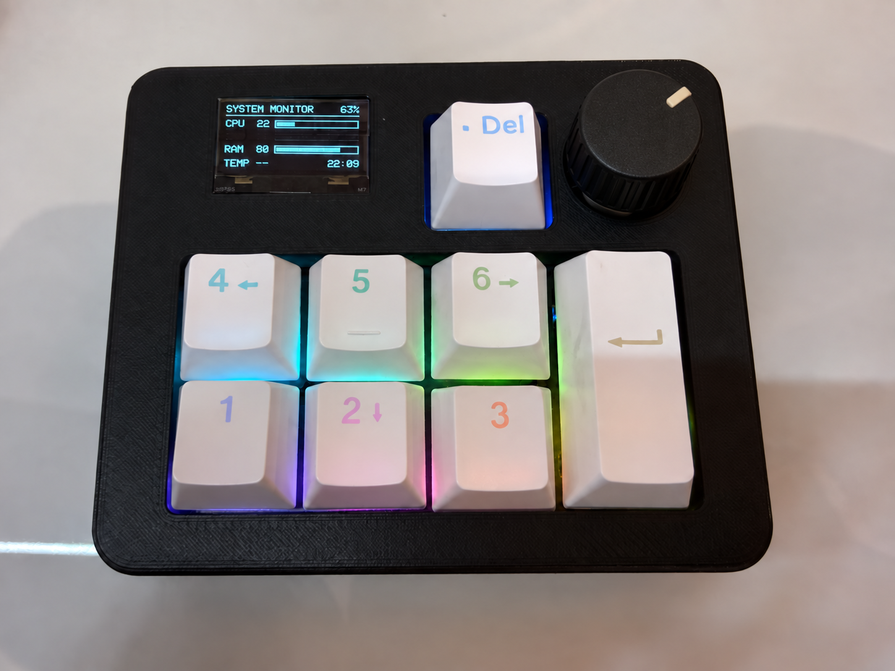

<div align="center">

# VicoPlay

**把 Vico Keyboard 变成一台桌面像素小游戏机。**


[快速开始](#快速开始) · [游戏与操作](#游戏与操作) · [开机动画](#开机动画) · [硬件与接线](#硬件与接线) · [开发与验证](#开发与验证)

</div>

VicoPlay 是为 [Vico Keyboard](https://github.com/Apezer/ESP32S3-Vico-Keyboard) 硬件开发的独立游戏固件，使用 **128×64 单色 OLED、EC11 旋钮和八个机械按键**，无需连接电脑即可离线游玩。

> 当前版本：**0.1.0 原型版**。已通过固件编译与桌面逻辑测试；显示效果、输入手感、电量精度及长时间稳定性仍需在实际设备上验证。

## 硬件实物

<p align="center">
  
</p>

*照片展示 Vico Keyboard 硬件，屏幕内容为键盘固件界面，并非 VicoPlay 游戏截图。*

## 主要功能

- **打砖块**：旋钮或按键移动挡板，包含砖块碰撞、得分与生命计数。
- **贪吃蛇**：支持四方向按键及旋钮相对转向，包含进食增长与碰撞判断。
- **俄罗斯方块**：支持移动、旋转、软降、硬降、消行与下一方块预览。
- **统一菜单**：旋钮选择游戏、按压进入，统一暂停与返回操作。
- **独立最高分**：每款游戏的纪录通过 Preferences 保存，重启后保留。
- **品牌开机动画**：像素箭头、从横线上浮的衬线字标与缓出动效。
- **电量与熄屏**：菜单显示电池估算电量，电池模式闲置自动关闭 OLED。

## 快速开始

### 方式一：烧录预构建固件

下载仓库中的 [vico-play-0.1.0-full.bin](release/vico-play-0.1.0-full.bin)，使用支持 ESP32-S3 的烧录工具，将该**完整镜像烧录到 `0x0`**。

安装 esptool 后，也可在仓库根目录使用以下命令（将 `COM5` 替换为设备端口）：

```powershell
python -m pip install "esptool>=4.11,<5"
python -m esptool --chip esp32s3 --port COM5 write_flash 0x0 release/vico-play-0.1.0-full.bin
```

烧录会替换设备上的键盘程序。恢复键盘功能时，请重新烧录 [Vico Keyboard 固件](https://github.com/Apezer/ESP32S3-Vico-Keyboard)。

### 方式二：从源码构建

安装 PlatformIO Core，或使用 VS Code 的 PlatformIO 扩展打开本项目：

```powershell
git clone git@github.com:Apezer/VicoPlay.git
cd VicoPlay
pio run
pio run -t upload --upload-port COM5
pio device monitor --port COM5 --baud 115200
```

项目环境名为 `vico_game`，目标板为 `dfrobot_firebeetle2_esp32s3`，已配置 OPI PSRAM。依赖由 PlatformIO 自动安装：Adafruit SSD1306、Adafruit GFX，以及框架内置的 Wire 和 Preferences。

**镜像区别：** `.pio/build/vico_game/firmware.bin` 仅为应用镜像，不可作为完整镜像写入 `0x0`；手动烧录请使用 `release/` 中的 `*-full.bin`，从源码上传则交由 PlatformIO 管理各分区地址。

## 游戏与操作

K1～K8 使用原键盘固件的逻辑编号，具体 GPIO 见下方接线表。

| 操作 | 菜单 | 打砖块 | 贪吃蛇 | 俄罗斯方块 |
| --- | --- | --- | --- | --- |
| 旋钮旋转 | 选择游戏 | 左右移动挡板 | 相对当前方向转弯 | 左右移动 |
| 旋钮按压 | 开始 | 发球 | — | 旋转 |
| K1 | — | 左移 | 左 | 左移 |
| K2 | 下一项 | — | 下 | 加速下落 |
| K3 | — | 右移 | 右 | 右移 |
| K4 | 开始 | 发球 | — | 旋转 |
| K5 | — | — | — | 直接落下 |
| K6 | 上一项 | 发球 | 上 | 旋转 |
| K7 | — | 暂停 | 暂停 | 暂停 |
| K8 | — | 返回菜单 | 返回菜单 | 返回菜单 |

- 暂停后按旋钮、K4 或 K7 继续；游戏结束后按旋钮或 K4 重开，K8 返回菜单。
- 最高分在游戏结束时保存；中途返回菜单不会保存本局成绩。
- 贪吃蛇禁止直接反向；旋钮顺时针/逆时针对应相对当前方向右转/左转。
- 俄罗斯方块使用 10×20 棋盘和简单的左右旋转修正，尚未实现完整 SRS、暂存或锁定延迟。

## 开机动画

按照品牌概念图设计为单色像素动画，完整时长约 **4.1 秒**：

| 阶段 | 时间 | 效果 |
| --- | --- | --- |
| 标志出现 | 0～350 ms | 左侧箭头像素依次点亮 |
| 横线展开 | 350～650 ms | 字标下方横线从左向右伸展 |
| 字标浮出 | 650～1650 ms | `VicoPlay` 从横线下方向上浮出，接近终点时减速 |
| 信息出现 | 1650～2000 ms | 显示 `MINI GAME CONSOLE` 和 `v0.1.0` |
| 完整定格 | 2000～3750 ms | 保持完整品牌画面 1.75 秒 |
| 进入菜单 | 3750～4100 ms | 由上向下擦除 |

字标采用 FreeSerif9pt7b 字体。上浮使用三次缓出曲线，配合横线下方的黑色遮罩实现浮出效果。修改 `src/boot_animation.h` 中的时间常量即可调整节奏。

动画非阻塞播放，任意机械按键或按压旋钮可跳过；跳过操作不会同时启动游戏。闲置熄屏后的唤醒不重复播放动画。

## 硬件与接线

| 部件 | 型号 / 参数 | GPIO |
| --- | --- | --- |
| 主控 | DFRobot FireBeetle 2 ESP32-S3 | — |
| OLED | SSD1306，128×64，I²C 地址 `0x3C` | SDA 10 / SCL 9 |
| K1～K4 | 机械按键，按下接 GND | 18 / 17 / 16 / 15 |
| K5～K8 | 机械按键，按下接 GND | 5 / 6 / 7 / 4 |
| EC11 | A / B / 按压开关 | 11 / 12 / 13 |
| 电池检测 | 100K / 100K 分压，100nF 滤波 | 14 |
| 模式拨片 | 低电平启用闲置熄屏策略 | 38 |
| RGB | 原硬件 WS2812B 数据脚，本版不驱动灯效 | 8 |

按键和旋钮开关使用内部上拉；OLED 使用 3.3V 电源。旋钮方向相反时，可调整 `src/rotary_encoder.h` 中的 `DIRECTION`。

电池电量通过电压曲线估算。GPIO38 为低电平且当前不在游玩状态时，无操作两分钟关闭 OLED，按键或旋钮操作可唤醒；本版不进入深度睡眠。GPIO38 不承担原键盘固件的 USB/BLE 模式切换功能。

## 项目结构

```text
VicoPlay/
├── platformio.ini             # 板级配置与依赖
├── .clang-format              # 统一 C++ 格式
├── src/
│   ├── main.cpp               # 输入、三款游戏、菜单与主循环
│   ├── boot_animation.h       # 开机动画时间轴与缓出曲线
│   ├── boot_screen.h          # 品牌画面与裁切绘制
│   ├── battery_monitor.*      # 电池采样、滤波与电量估算
│   ├── rotary_encoder.*       # EC11 旋转与按压事件
│   └── encoder_decoder.h      # 正交解码与抖动过滤
├── test/
│   ├── logic_test.cpp         # 桌面游戏逻辑与动画测试
│   └── stubs/                 # 桌面外设桩
├── docs/images/               # 文档图片
└── release/                   # 可从 0x0 烧录的完整镜像
```

## 开发与验证

### 桌面逻辑测试

需要支持 C++17 的 g++，在仓库根目录运行：

```powershell
g++ -std=c++17 -Itest/stubs test/logic_test.cpp -o test/logic_test.exe
./test/logic_test.exe
```

覆盖贪吃蛇反向限制、撞墙和增长，俄罗斯方块消行与旋转单元数量，打砖块生命耗尽和挡板边界，以及动画自动结束、跳过、计时回绕和上浮偏移的单调性。

外设桩测试不验证真实 OLED、Flash 持久化、蓝牙、USB 或硬件时序。当前编译结果：静态 RAM 约 **23 KB**，应用程序约 **307 KB**；这些数值不代表运行时峰值内存。

### 代码格式

采用四空格缩进、100 字符行宽，条件与循环统一使用大括号。使用 clang-format 23 可按 `.clang-format` 重新整理源码。

### 实机检查

1. 开机字标上浮平滑，副标题与版本号完整，按键跳过不误启动游戏。
2. 三款游戏的操作、失败/获胜、重开、暂停和返回菜单正常。
3. 结束一局产生最高分后，重新上电仍能读取纪录。
4. 电池读数合理，菜单闲置熄屏后可正常唤醒。
5. 连续游玩并重复切换游戏，检查显示、输入和稳定性。

## 当前范围

游戏离线运行，界面为英文点阵。显示目标约 25 FPS，实际速度受 I²C 传输和主循环负载影响。本版不提供 USB/BLE 键盘功能、麦克风、网络、音效或 RGB 动画。

## 致谢与相关项目

游戏逻辑独立编写，旋钮与电池模块沿用 Vico Keyboard 固件。显示使用 Adafruit SSD1306 / Adafruit GFX，字体来自 Adafruit GFX 的 FreeFont 字库；依赖的许可和署名以各自项目为准。

- [Vico Keyboard 固件](https://github.com/Apezer/ESP32S3-Vico-Keyboard)
- [VicoDeck 配套软件](https://github.com/Apezer/vico-deck)
- [官方网站](https://www.vicovico.xyz/)
